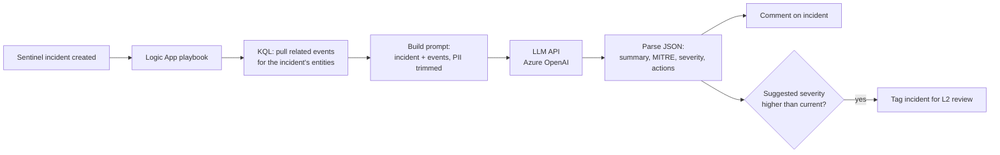

# AI-Assisted Alert Triage for Microsoft Sentinel

> **Status: in progress.** This repo holds the design, prompts and KQL for the build. Screenshots and the exported Logic App will be added as each stage is completed.

## 🎯 Goal
L1 analysts spend most of their time reading raw alerts, pulling context and deciding whether to escalate. This project adds a **Logic Apps + LLM** step to Microsoft Sentinel that, for every new incident:

1. gathers the incident's entities and related log events with KQL,
2. asks a large language model for a **short summary, likely MITRE ATT&CK technique, suggested severity and next steps**, and
3. writes the result back to the incident as a comment, so the analyst starts with context instead of a blank page.

The analyst still makes every decision. The model only summarises and suggests.

## 🏗️ Architecture

## 🛠️ Stack
Microsoft Sentinel · Log Analytics · KQL · Azure Logic Apps · Azure OpenAI (or another LLM API over HTTPS) · Managed Identity

## 📁 Repo layout
| Path | Contents |
| :--- | :--- |
| [`prompts/triage-prompt.md`](prompts/triage-prompt.md) | System prompt and the JSON output schema the model must return |
| [`kql/incident-context.kql`](kql/incident-context.kql) | Pulls the events around an incident's IP and account entities |
| [`playbook/README.md`](playbook/README.md) | Step-by-step Logic App design |
| [`docs/evaluation.md`](docs/evaluation.md) | How the output will be checked against analyst decisions |

## 🗺️ Roadmap
- [x] Design: architecture, prompt and output schema
- [x] KQL to collect incident context
- [ ] Logic App: incident trigger → KQL → LLM call → incident comment
- [ ] Managed Identity and Key Vault for secrets (no keys in the workflow)
- [ ] Test on brute-force incidents from my [Sentinel honeypot lab](https://github.com/uditprak/Sentinel-SIEM-SOAR)
- [ ] Evaluate: compare suggested severity with my own triage on 20+ incidents
- [ ] Export the Logic App JSON and add screenshots

## 🔐 Guardrails
- Send only the fields the model needs (no secrets, trimmed usernames where possible).
- The model never closes, deletes or remediates anything. It only comments and tags.
- Every suggestion is labelled "AI-generated" in the incident comment.
- Invalid or empty model output → the playbook posts nothing and logs the failure.
